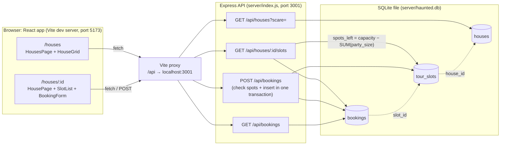

# Haunted House Tours

A haunted house tour site where visitors browse houses by scare level (mild, spooky, terrifying), open a house to see its tour times with spots left, and book spots. Tours can never be overbooked.

## Stack
- **Front end:** React + Vite + React Router (in `client/`)
- **Back end:** Node + Express + SQLite via better-sqlite3 (in `server/`)

## Architecture



The browser never talks to the database. Pages call `/api/...`, Vite forwards those calls to Express, and Express reads and writes SQLite. `spots_left` is calculated in SQL on every request, never stored.

## What you need installed
- [Node.js](https://nodejs.org/) **22.12 or newer** (this includes `npm`). better-sqlite3 requires Node 22, and Vite requires 22.12+. Check with `node -v`.
- Git

## Install
```bash
git clone https://github.com/anikethbuddolla/haunted-house-tours.git
cd haunted-house-tours
cd server && npm install
cd ../client && npm install
```

## Run (two terminals)

**Terminal 1: API server** (port 3001)
```bash
cd server
npm start
```
You should see `API running at http://localhost:3001`. The first run creates `server/haunted.db`, fills it with the houses from `client/src/data/houses.json`, and adds 3 tour slots per house (Oct 31, capacities 4 to 10).

**Terminal 2: React app** (port 5173)
```bash
cd client
npm run dev
```

Then open **http://localhost:5173** in your browser.

The React dev server forwards every `/api/...` request to the API on port 3001 (see `client/vite.config.js`), so both must be running.

## Demo path
1. Open **Houses** and click **View tour times** on any house.
2. Pick a time (with its **Book** button or the dropdown), then enter a name, email and party size, and click **Book**.
3. Spots left drops right away. Refresh the page and it is still lower.
4. Try a party size bigger than the spots left: you see "Not enough spots left".
5. Book a slot down to 0: it shows **Full** and its button is disabled.

## Pages
- `/`: home page
- `/houses`: house grid with a scare-level filter and a "My Tour" list
- `/houses/:id`: one house's tour times with spots left, and the booking form

## API
See [API_CONTRACT.md](API_CONTRACT.md). Quick check with the API running:
```bash
curl http://localhost:3001/api/houses/1/slots
```

## Automated checks
With the API running (Terminal 1), open a third terminal:
```bash
cd server
npm run check
```
This sends real requests and prints PASS/FAIL for: slots with spots_left, a valid booking dropping spots_left, an empty name (400), an empty email (400), overbooking (409), a missing slot (404), and booking a slot down to 0. It deletes its own test bookings at the end, and exits with code 1 if anything fails.

## Reset the data
Stop the API, delete `server/haunted.db`, and start it again. The houses and slots are re-seeded and all bookings are cleared.

## Known issues
All five acceptance criteria and all `npm run check` tests pass (see [ACCEPTANCE.md](ACCEPTANCE.md)). These limitations are still open:
- **Unknown URLs show an empty page.** A path like `/book` (the old booking page) or `/anything` shows only the nav bar. There is no "page not found" page.
- **Email format is not checked.** The server only checks that email is not empty, so `abc` is accepted. The browser's email field catches most typos in the UI, but the API itself does not.
- **"My Tour" is not saved.** The tour list on `/houses` lives in React state and resets on a page refresh. It is separate from bookings, which are saved.
- **Losing the server right after booking hides the confirmation.** If the API goes down between a successful booking and the slots refresh, the house page switches to the error and Retry view, so the "Booked!" message is no longer visible. The booking itself is saved.
- **Unknown API paths return HTML.** For example, `/api/nope` gets Express's default HTML 404 instead of JSON. The four documented routes always return JSON.
- **Dev setup only.** It runs on the Vite dev server with a local SQLite file. There is no production build setup or deployment (out of scope).
